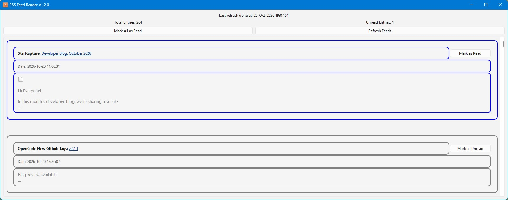

# pyAggregatedRssFeedReader
A simple aggregator for multiple RSS feeds; It has very handy features, like:
- it marks the already read entries
- can mark individual entries as read or unread (via a button on each entry)
- it will check for new entries every 30 minutes
- it displays a counter with all unread entries/ total entries
- can set all the entries as read (via an easy-to-use button)
- can manually refresh all feeds (via an easy-to-use button)
- persistent history for all read entries
- the taskbar icon will flash if there are unread entries

# Usage
- [end-user] Can be used via the bundled executable (available in [Releases](https://github.com/ageorge95/pyAggregatedRssFeedReader/releases))
- [end-user] Can be used by running `powershell -ExecutionPolicy Bypass -File _install\install.ps1` and after that `START_RSSreader.bat`
- [dev] Can be built as an exe by running `powershell -ExecutionPolicy Bypass -File _install\install.ps1` and after that `BUILD_release.bat`

# GUI layout

# Support
Found this project useful? Send your ❤ in any form you can 🙂. Please contact me if you donated and want to be added to the contributors list !

- chia XCH---xch1glz7ufrfw9xfp5rnlxxh9mt9vk9yc8yjseet5c6u0mmykq8cpseqna6494
